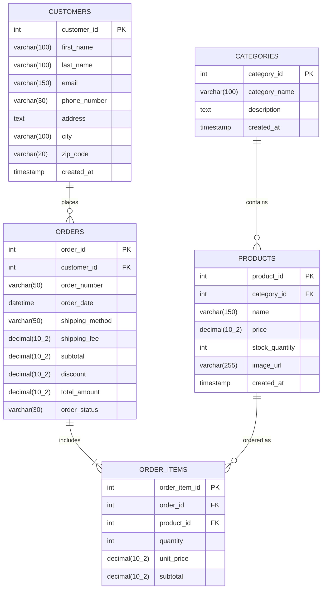

# E-Commerce Database ERD (Entity-Relationship Diagram)

Practical Exercise: Database Design for E-Commerce Order System.

## Tables Overview
1. **Customers**: Stores customer personal details and delivery addresses.
2. **Categories**: Groups products into catalog categories.
3. **Products**: Master catalog with pricing and inventory.
4. **Orders**: Customer order headers, shipping details, and status.
5. **Order_Items**: Line items purchased under each order.

---

## 1. Visual Entity-Relationship Diagram (Mermaid)



---

## 2. Table Relationships Description

1. **`Categories` (1) ──── (N) `Products`**
   - **Type**: One-to-Many
   - **Foreign Key**: `Products.category_id` references `Categories.category_id`
   - **Meaning**: A single category (e.g. Computers, Displays, Accessories) can contain multiple products, while each product belongs to one specific category.

2. **`Customers` (1) ──── (N) `Orders`**
   - **Type**: One-to-Many
   - **Foreign Key**: `Orders.customer_id` references `Customers.customer_id`
   - **Meaning**: A customer can place many orders over time. Each order is tied directly to the customer who placed it.

3. **`Orders` (1) ──── (N) `Order_Items`**
   - **Type**: One-to-Many
   - **Foreign Key**: `Order_Items.order_id` references `Orders.order_id`
   - **Meaning**: An order can contain multiple line items (products and their respective quantities).

4. **`Products` (1) ──── (N) `Order_Items`**
   - **Type**: One-to-Many
   - **Foreign Key**: `Order_Items.product_id` references `Products.product_id`
   - **Meaning**: A product (e.g. Laptop, Mouse) can be ordered across many different customer orders.

---

## 3. SQL DDL Schema Script

```sql
-- 1. Customers Table
CREATE TABLE Customers (
    customer_id INT AUTO_INCREMENT PRIMARY KEY,
    first_name VARCHAR(100) NOT NULL,
    last_name VARCHAR(100) NOT NULL,
    email VARCHAR(150) NOT NULL UNIQUE,
    phone_number VARCHAR(30) NOT NULL,
    address TEXT NOT NULL,
    city VARCHAR(100) NOT NULL,
    zip_code VARCHAR(20) NOT NULL,
    created_at TIMESTAMP DEFAULT CURRENT_TIMESTAMP
);

-- 2. Categories Table
CREATE TABLE Categories (
    category_id INT AUTO_INCREMENT PRIMARY KEY,
    category_name VARCHAR(100) NOT NULL,
    description TEXT,
    created_at TIMESTAMP DEFAULT CURRENT_TIMESTAMP
);

-- 3. Products Table
CREATE TABLE Products (
    product_id INT AUTO_INCREMENT PRIMARY KEY,
    category_id INT NOT NULL,
    name VARCHAR(150) NOT NULL,
    price DECIMAL(10, 2) NOT NULL,
    stock_quantity INT NOT NULL DEFAULT 0,
    image_url VARCHAR(255),
    created_at TIMESTAMP DEFAULT CURRENT_TIMESTAMP,
    CONSTRAINT fk_products_category
        FOREIGN KEY (category_id) REFERENCES Categories(category_id)
        ON DELETE RESTRICT ON UPDATE CASCADE
);

-- 4. Orders Table
CREATE TABLE Orders (
    order_id INT AUTO_INCREMENT PRIMARY KEY,
    customer_id INT NOT NULL,
    order_number VARCHAR(50) NOT NULL UNIQUE,
    order_date DATETIME NOT NULL DEFAULT CURRENT_TIMESTAMP,
    shipping_method VARCHAR(50) NOT NULL,
    shipping_fee DECIMAL(10, 2) NOT NULL DEFAULT 0.00,
    subtotal DECIMAL(10, 2) NOT NULL,
    discount DECIMAL(10, 2) NOT NULL DEFAULT 0.00,
    total_amount DECIMAL(10, 2) NOT NULL,
    order_status VARCHAR(30) NOT NULL DEFAULT 'Pending',
    CONSTRAINT fk_orders_customer
        FOREIGN KEY (customer_id) REFERENCES Customers(customer_id)
        ON DELETE RESTRICT ON UPDATE CASCADE
);

-- 5. Order_Items Table
CREATE TABLE Order_Items (
    order_item_id INT AUTO_INCREMENT PRIMARY KEY,
    order_id INT NOT NULL,
    product_id INT NOT NULL,
    quantity INT NOT NULL CHECK (quantity > 0),
    unit_price DECIMAL(10, 2) NOT NULL,
    subtotal DECIMAL(10, 2) NOT NULL,
    CONSTRAINT fk_order_items_order
        FOREIGN KEY (order_id) REFERENCES Orders(order_id)
        ON DELETE CASCADE ON UPDATE CASCADE,
    CONSTRAINT fk_order_items_product
        FOREIGN KEY (product_id) REFERENCES Products(product_id)
        ON DELETE RESTRICT ON UPDATE CASCADE
);

-- Pre-populating the 4 products from Practical Exercise 1:
INSERT INTO Categories (category_id, category_name) VALUES
(1, 'Computers'),
(2, 'Accessories'),
(3, 'Displays');

INSERT INTO Products (product_id, category_id, name, price, stock_quantity) VALUES
(1, 1, 'Laptop', 650.00, 12),
(2, 2, 'Mouse', 15.00, 45),
(3, 2, 'Keyboard', 25.00, 28),
(4, 3, 'Monitor', 120.00, 15);
```
